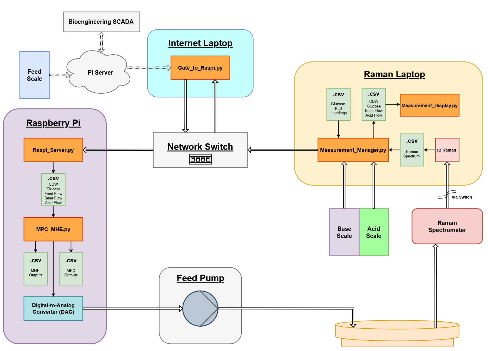
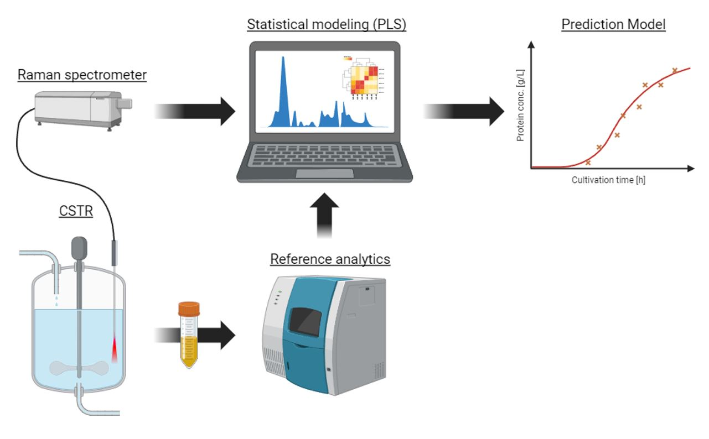
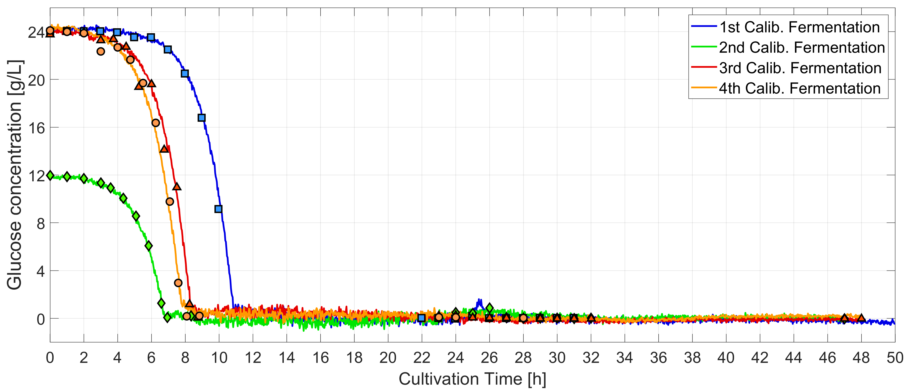
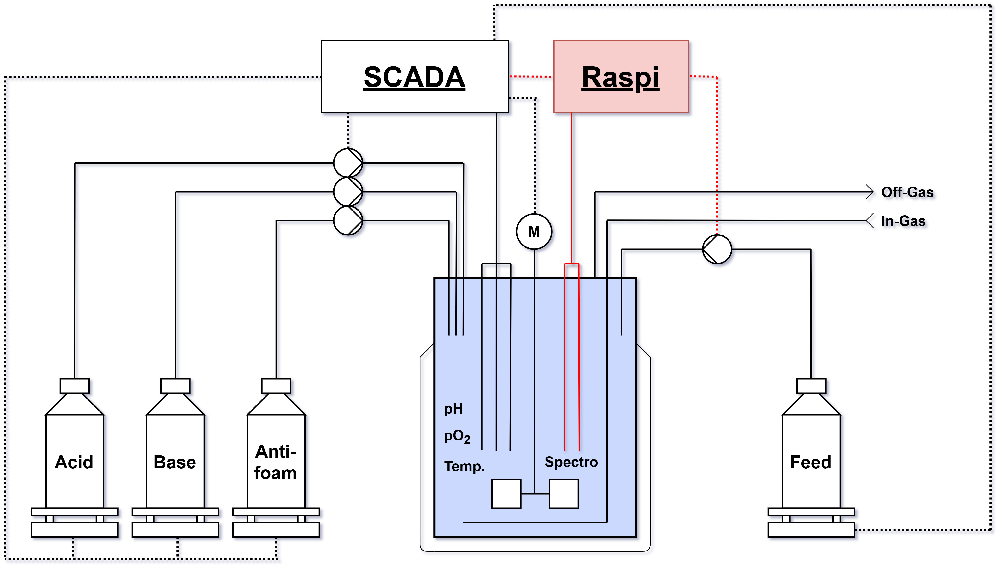
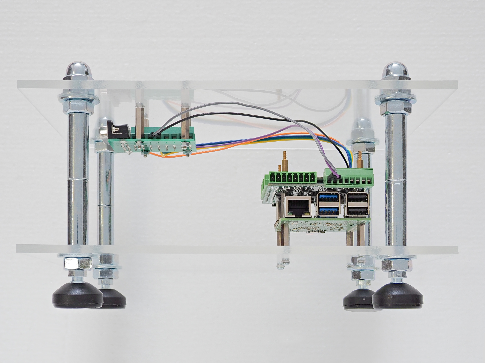
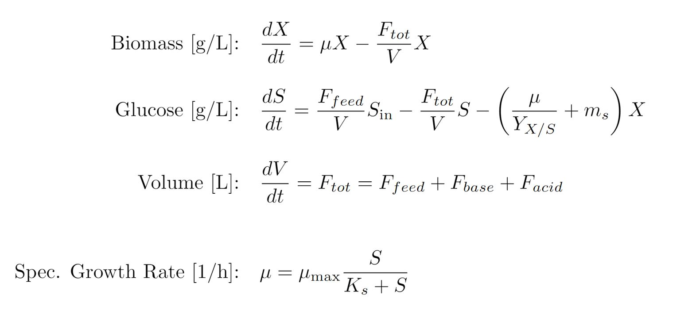
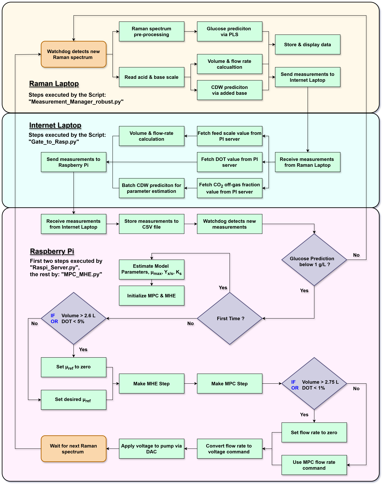
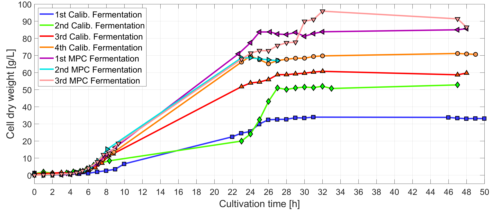

# Real-Time Monitoring and Model Predictive Control for Inclusion Body Fermentations

Code from my MSc thesis (*Master of Science HES-SO in Life Sciences, Applied Biosciences, 2025*), carried out at the HES-SO Valais/Wallis.



## Motivation

*E. coli* fed-batch fermentations are usually run **open-loop** with a pre-calculated exponential feed profile. The profile cannot react to batch-to-batch variability, oxygen limitation or deviations from the expected growth. This project replaces the fixed profile with a **Model Predictive Controller (MPC)**. It is fed by **in-line Raman spectroscopy**, so the feed rate is recalculated every 2 minutes from the actual state of the culture.

The model product was **nattokinase**, a fibrinolytic enzyme that *E. coli* expresses as inclusion bodies (IBs).

In the 3rd MPC fermentation the controller outperformed the best open-loop run:

| | Best open-loop | 3rd MPC fermentation |
|---|---|---|
| Max. biomass (CDW) | 71.1 g/L | **95.9 g/L** |
| Volumetric nattokinase productivity | 592.9 mg/(L·h) | **822.4 mg/(L·h)** |

## How it works

### 1. Soft sensor: glucose from Raman spectra

A PLS regression model was calibrated on four open-loop calibration fermentations. It used in-line Raman spectra and offline reference analytics (HPLC). The model predicts glucose with an RMSE<sub>CV</sub> of 0.44 ± 0.15 g/L. Biomass is estimated from the cumulative amount of base added for pH control. Volume comes from a mass balance over the feed, base and acid scales.





### 2. Data pipeline across three machines

The Raman spectrometer acts as the clock of the control loop. Each new spectrum (every 2 min) starts a chain of scripts that pass data between devices over TCP/IP sockets on the local network:

| Machine | Script | Task |
|---|---|---|
| **Raman laptop** | `Measurement_Manager_robust_*.py` | Watches for new spectra, pre-processes them, predicts glucose (PLS), reads base/acid scales over RS-232, estimates CDW and flow rates, sends everything on |
| **Internet laptop** | `Gate_to_Raspi_*.py` | Gateway to the plant's PI server. Adds feed scale, DOT and CO₂ off-gas values, then forwards the packet to the Raspberry Pi. Needed because the Raman laptop and the Pi have no internet access |
| **Raspberry Pi 5** | `Raspi_Server_*.py`, `MPC_MHE_*.py` | Receives and logs measurements, runs state estimation and MPC, and sets the feed pump through a 0-10 V DAC (Sequent Microsystems MEGA-IND) |



The Raspberry Pi and DAC were mounted in a custom housing and wired to the Watson Marlow 120U feed pump through a D-Sub adapter. Besides the analog flow command, GPIO pins control start/stop, auto/manual mode and pump direction.



### 3. MPC and MHE

The controller is built on [do-mpc](https://www.do-mpc.com) (v4.6.5), which uses CasADi and IPOPT. The process is described by a simple unstructured Monod model with three states (biomass *X*, glucose *S*, volume *V*):



- **Moving Horizon Estimation (MHE)**, horizon 10 steps: fuses the noisy glucose, biomass and volume measurements with the model into a smooth state estimate.
- **MPC**, horizon 20 steps (40 min): tracks a reference trajectory for the specific growth rate *μ*<sub>ref</sub>, which decays exponentially from 0.4 to 0.1 h⁻¹. The aim is a roughly constant oxygen demand. Changes in the feed rate are penalised so the pump doesn't oscillate:

  *J* = Σ (*μ*<sub>k</sub> − *μ*<sub>k</sub><sup>ref</sup>)² + (*r* · Δ*F*<sub>feed,k</sub>)²
- **Automatic parameter estimation:** when glucose drops below 1 g/L (end of the batch phase), *μ*<sub>max</sub>, *Y*<sub>X/S</sub> and *K*<sub>s</sub> are fitted to the last 3 h of batch data with SciPy. MPC and MHE are then initialised with these values, so the switch from batch to fed-batch is fully automatic.
- **Safety logic:** *μ*<sub>ref</sub> is set to 0 if DOT < 5 % or *V* > 2.6 L. The pump is stopped outright if DOT < 1 % or *V* > 2.75 L.



### Result



## Repository structure

```
Scripts/
├── MPC_Scripts/
│   ├── 1st_MPC_Fermentation/      # code version used in each MPC run
│   ├── 2nd_MPC_Fermentation/      #   (iteratively improved between runs)
│   ├── 3rd_MPC_Fermentation/      # final version
│   └── Misc/                      # live glucose/CDW display, audio alarms
├── AutoCalibration_Feed_Pump/     # automated RPM -> mass-flow calibration of the feed pump
├── OpenLoop_Feed_Controller/      # exponential feed profile for the calibration runs
├── Direct_Pump_Control/           # GPIO helpers: start/stop, direction, auto/manual
└── Avasoft/                       # UV/VIS/NIR (AvaSpec-2048) time-series acquisition on the Pi
Figures/                           # figures used in this README
```

## Notes

This repository **documents how the system was built**. It is not a plug-and-play package. The scripts depend on a specific lab setup: hard-coded static IPs, file paths on the lab PCs, a Bioengineering SCADA with an OSIsoft PI server, and specific scales and pumps.

**Main dependencies:**
- Python packages: `do-mpc`, `casadi`, `numpy`, `scipy`, `pandas`, `matplotlib`, `watchdog`, `pyserial`, `PIconnect`, `python-dotenv`, `apscheduler`
- On the Raspberry Pi: `megaind` (Sequent Microsystems) and `gpiod`
- The AvaSpec scripts also need the Avantes library (`avaspec.py` + DLL/.so), which is free from [Avantes](https://www.avantes.com/products/software/) and not included. See also [Avantes_Spectrometer_GUI](https://github.com/basil-imoberdorf/Avantes_Spectrometer_GUI).

**PI-server credentials** are read from a `.env` file, which is not part of the repository. To run the gateway or pump-calibration scripts, copy `.env.example` to `.env` and fill in your own values.

## Acknowledgements

Supervised by Prof. Dr. Matthias Rüdt and Prof. Dr. Nils Hanik in the laboratory of Prof. Dr. Manfred Zinn, HES-SO Valais/Wallis.
